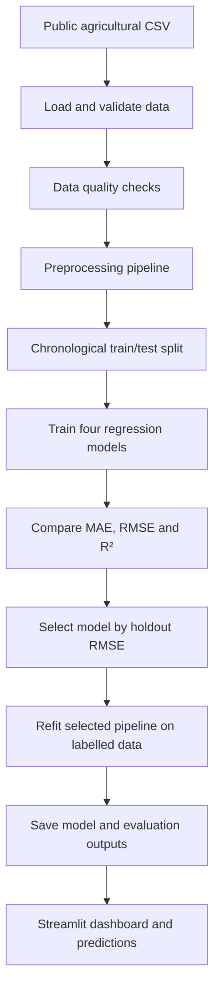

# 🌾 AgriYield AI
### Machine Learning-Based Crop Yield Prediction and Agricultural Decision Support System

AgriYield AI is an end-to-end machine learning project that explores historical crop-yield patterns across Indian states. It combines data validation, exploratory data analysis, regression-model comparison, and an interactive Streamlit dashboard for agricultural data exploration and yield estimation.

> **Academic prototype:** AgriYield AI is intended for learning and demonstration. Its predictions are estimates based on historical data—not guaranteed outcomes or a substitute for local agronomic advice.

---

## Contents
- [Project Overview](#project-overview)
- [Key Features](#key-features)
- [How It Works](#how-it-works)
- [Dataset](#dataset)
- [Machine Learning Methodology](#machine-learning-methodology)
- [Project Structure](#project-structure)
- [Getting Started on Windows](#getting-started-on-windows)
- [Train the Models](#train-the-models)
- [Launch the Dashboard](#launch-the-dashboard)
- [Run the Tests](#run-the-tests)
- [Evaluation Metrics](#evaluation-metrics)
- [Limitations and Future Scope](#limitations-and-future-scope)
- [Acknowledgements](#acknowledgements)

## Project Overview

Crop yield is influenced by several interacting factors, including crop type, season, rainfall, and agricultural inputs. This project uses a supervised regression workflow to study relationships in historical Indian agricultural data and estimate crop yield from selected input features.

**Project objectives**
1. Prepare and validate the source dataset for analysis.
2. Explore agricultural data and summarize data quality.
3. Train and compare multiple regression algorithms using a consistent evaluation protocol.
4. Reduce target leakage by excluding columns that directly define yield.
5. Present the dataset, model results, and interactive predictions in a Streamlit dashboard.
6. Maintain a reproducible codebase with automated tests.

## Key Features

- **Dataset validation:** checks the downloaded CSV and expected schema before caching it locally.
- **Exploratory analysis:** dashboard views for understanding the dataset and its distributions.
- **Leakage-aware preprocessing:** imputes missing values and one-hot encodes categorical variables within model pipelines.
- **Four regression models:** Linear Regression, Decision Tree, Random Forest, and Gradient Boosting.
- **Chronological evaluation:** by default, the latest three observed years are held out for testing.
- **Model comparison:** reports Mean Absolute Error (MAE), Root Mean Squared Error (RMSE), and R².
- **Interactive predictions:** Streamlit form for estimating yield from selected crop and environmental inputs.
- **Saved artifacts:** model pipeline and evaluation outputs are generated locally.
- **Automated tests:** test coverage for key modeling and data-loader behaviour.

## How It Works



The dashboard is launched separately from model training. Run the training script first to generate the model and evaluation files used by the app.

## Dataset

The project uses the public dataset **`crop_yield_in_indian_states.csv`** from the [jainvandan7/crop-yield-ml repository](https://github.com/jainvandan7/crop-yield-ml). The source repository describes 19,689 observations spanning 1997–2020 and the following columns:

| Column | Description |
|---|---|
| `Crop` | Crop category |
| `Crop_Year` | Year of observation |
| `Season` | Agricultural season |
| `State` | Indian state |
| `Area` | Cultivated area |
| `Production` | Recorded crop production |
| `Annual_Rainfall` | Annual rainfall value |
| `Fertilizer` | Fertilizer usage value |
| `Pesticide` | Pesticide usage value |
| `Yield` | Target variable to estimate |

The dataset is downloaded automatically by `src/data_loader.py` when it is not already present in `data/raw/`. The downloaded file is validated before it is saved locally. You can also place the source CSV in that folder yourself.

### Target and predictors

- **Target:** `Yield`
- **Predictors:** `Crop`, `Crop_Year`, `Season`, `State`, `Annual_Rainfall`, `Fertilizer`, and `Pesticide`
- **Excluded from predictors:** `Area` and `Production`

Area and Production are excluded because yield in this dataset is derived from production relative to area. Including them could leak information about the target into the model.

**Dataset source links:** [Source repository](https://github.com/jainvandan7/crop-yield-ml) · [CSV file](https://github.com/jainvandan7/crop-yield-ml/blob/main/crop_yield_in_indian_states.csv)

Please review the source repository's current usage terms and cite the dataset source in any academic submission.

## Machine Learning Methodology

### 1. Data preparation
The pipeline checks the source structure, prepares the target and predictor columns, and excludes rows that cannot be used as labelled examples.

### 2. Preprocessing
- Categorical features are imputed using the most frequent value and one-hot encoded.
- Numeric features are imputed using the median.
- Preprocessing is fitted within each model pipeline to help prevent information leakage between training and test data.

### 3. Model training and validation
The project compares four regression algorithms:

| Model | Purpose |
|---|---|
| Linear Regression | Baseline linear relationship |
| Decision Tree Regressor | Learns nonlinear decision rules |
| Random Forest Regressor | Combines multiple decision trees |
| Gradient Boosting Regressor | Builds an ensemble sequentially to reduce prediction error |

By default, the evaluation uses a **chronological holdout**: the latest three observed years are reserved for testing, while earlier years are used for training. This is more representative of predicting later years than randomly splitting individual rows, although it does not eliminate all sources of evaluation bias. Rows without a valid year are excluded from this chronological holdout.

The model with the lowest holdout RMSE is selected. The selected pipeline is then refitted on all labelled rows for use by the demonstration dashboard. Evaluation metrics are calculated from the holdout predictions before this refitting step.

### 4. Generated outputs

After training, the script can generate:

- `models/best_model.joblib` — selected model pipeline
- `reports/model_comparison.csv` — model evaluation metrics
- `reports/test_predictions.csv` — holdout predictions
- `reports/feature_importance.csv` — feature importance when supported by the selected model

These files are generated locally and may be excluded from version control. Use the results from your own successful run in the project report; metrics can vary with the data and evaluation setup.

## Project Structure

```text
AgriYield_AI/
├── app.py                       # Streamlit dashboard
├── train_models.py              # Training and evaluation entry point
├── requirements.txt              # Python dependencies
├── README.md
├── docs/
│   └── REPORT_TEMPLATE.md        # Academic report outline/template
├── data/
│   ├── raw/                      # Downloaded source dataset (local)
│   └── processed/                # Generated processed outputs (local)
├── models/                       # Saved model pipeline (generated)
├── reports/                      # Evaluation outputs (generated)
├── src/
│   ├── __init__.py
│   ├── data_loader.py             # Dataset download and validation
│   ├── preprocessing.py           # Data preparation and quality checks
│   ├── modeling.py                # Model pipelines and comparison
│   └── evaluation.py              # Evaluation output saving
└── tests/
    ├── test_preprocessing.py
    ├── test_modeling.py
    └── test_data_loader.py
```

## Getting Started on Windows

The following steps use **Windows PowerShell in VS Code**.

### 1. Clone the repository

```powershell
git clone https://github.com/Smitt1803/AgriYield-AI.git
cd AgriYield-AI
```

### 2. Create and activate a virtual environment

Python 3.11 or 3.12 is recommended.

```powershell
py -3.12 -m venv .venv
.\.venv\Scripts\Activate.ps1
```

If PowerShell blocks environment activation, run this in the current terminal and retry activation:

```powershell
Set-ExecutionPolicy -Scope Process -ExecutionPolicy Bypass
.\.venv\Scripts\Activate.ps1
```

### 3. Install dependencies

```powershell
python -m pip install --upgrade pip
pip install -r requirements.txt
```

## Train the Models

With the virtual environment active, run:

```powershell
python train_models.py
```

The script loads and validates the dataset, prints a data-quality summary, trains and compares the models, selects a model using holdout RMSE, and saves the generated artifacts. The first run requires an internet connection unless the dataset CSV is already available in `data/raw/`.

## Launch the Dashboard

Train the models before starting the app:

```powershell
streamlit run app.py
```

Open the local address shown in the terminal—typically [http://localhost:8501](http://localhost:8501).

The dashboard provides dataset exploration, model comparison, yield prediction, and dataset/methodology information. Predictions are estimates; inputs outside the historical data range may not be well represented by the training data.

## Run the Tests

```powershell
python -m pytest -q
```

The current project test suite has been run successfully with **13 passing tests**. The tests use local fixtures for tested functionality and do not require downloading the full dataset. Run the command again after changing the code to verify your own working copy.

## Evaluation Metrics

| Metric | Interpretation | Preferred direction |
|---|---|---|
| MAE | Average absolute difference between predicted and observed yield | Lower |
| RMSE | Square root of mean squared prediction error; penalizes larger errors more strongly | Lower |
| R² | Measures performance relative to predicting the test-set mean | Generally higher |

MAE and RMSE are expressed in the dataset's yield units; R² is unitless and can be negative on held-out data. Compare metrics using the same test split and dataset. Do not treat a high R² by itself as proof that a model will generalize to every crop, state, or future year.

## Limitations and Future Scope

- The source data reflects historical reporting and may not capture every factor that affects crop yield.
- Soil properties, irrigation, local pest conditions, within-season weather, and farm-level practices are not fully represented by the current predictor set.
- Historical patterns do not guarantee future performance; changes in climate, farming practices, and reporting can affect predictions.
- The chronological holdout provides a more time-aware evaluation than a random split, but additional validation across states, crops, and time periods would strengthen the assessment.
- Feature importance describes model associations and should not be interpreted as evidence of causation.

**Possible future improvements**
- Add external soil, irrigation, and weather data.
- Evaluate performance separately by crop, state, and year.
- Add prediction intervals or uncertainty estimates.
- Compare additional algorithms and tuning strategies.
- Validate results with agricultural domain experts before considering real-world use.

## Acknowledgements

- **Dataset:** [jainvandan7/crop-yield-ml](https://github.com/jainvandan7/crop-yield-ml)
- **Core tools:** Python, pandas, scikit-learn, Streamlit, matplotlib, seaborn, and pytest.

---

**Project:** AgriYield AI — Machine Learning-Based Crop Yield Prediction and Agricultural Decision Support System  
**Purpose:** Academic machine learning and data analytics project
